# CinemaUSAC — Manual de Usuario (Fase 3)

**Estudiante:** Dalio Antonio Miranda Guerra — **Carné:** 202100116
**Curso:** Estructuras de Datos, 2S2026 — USAC

Este manual explica cómo usar las funciones nuevas de la Fase 3: sedes, compras con blockchain y reportes. Las funciones de las fases anteriores (cartelera, promociones, solicitudes, funciones y clientes) siguen disponibles.

---

## 1. Iniciar el programa

1. Compilar el proyecto (ver el manual técnico, sección 12).
2. Abrir `CinemaUSAC_Fase3.exe` **desde la carpeta `build/`**.
3. Aparece la pantalla de inicio con dos botones: **Ingresar como Administrador** e **Ingresar como Cliente**.

Si en una ejecución anterior se cerró el programa, el sistema **recupera solo** las sedes, películas y funciones guardadas (archivos `.edd`) y verifica que la blockchain no haya sido manipulada.

---

## 2. Administrador

### 2.1 Iniciar sesión

1. Presionar **Ingresar como Administrador**.
2. Escribir las credenciales:
   - **Correo:** `AdminCine@gmail.com`
   - **Contraseña:** `admin123Pass`
3. Presionar **OK**. Con credenciales incorrectas aparece "Acceso denegado".

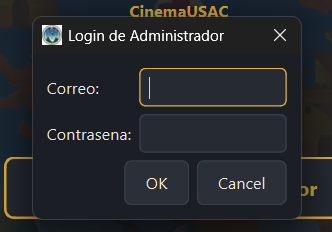

### 2.2 Carga masiva de sedes, películas y funciones

1. Ir a la pestaña **Funciones (Fase 2)**.
2. Presionar **Cargar JSON (Peliculas+Funciones)** y elegir el archivo (por ejemplo `data/peliculas_fase3_completo.json`).
3. Aparece el cuadro **Resultado de la carga masiva** con la cantidad de registros exitosos y rechazados, y el motivo de cada rechazo.
4. La tabla de funciones muestra ahora las columnas **Sede** y **Fecha**.

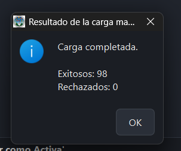

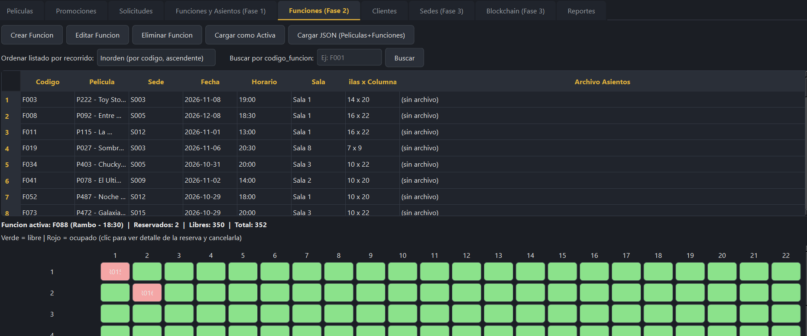

> Los registros inválidos (sede inexistente, fecha mal escrita, duración que no es número, código repetido) se rechazan sin detener el resto de la carga.

### 2.3 Gestión de sedes

Ir a la pestaña **Sedes (Fase 3)**. Tiene cuatro secciones:

**Sedes.** Lista todas las sedes y permite registrar una nueva con **Registrar Nueva Sede** (código, nombre, dirección, cantidad de salas y teléfono).

- **Editar Sede Seleccionada:** seleccioná una fila de la tabla y presioná el botón para cambiar nombre, dirección, salas o teléfono. El código no se puede cambiar.
- **Eliminar Sede Seleccionada:** seleccioná una fila y presioná el botón. El sistema pide confirmación y quita la sede y todas sus conexiones del grafo. Si la sede tiene funciones, **también se eliminan** (con sus archivos de asientos), y el aviso te dice cuántas son.

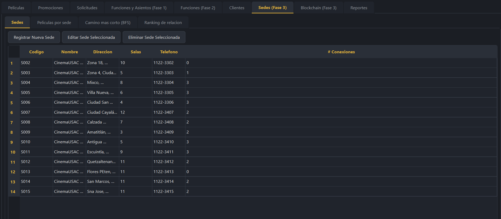

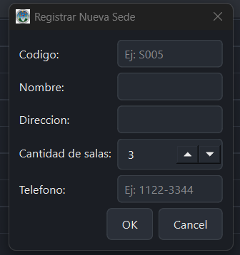

**Peliculas por sede.** Escribir el código de una sede (por ejemplo `S001`) y presionar **Ver Peliculas** para ver qué se proyecta ahí.

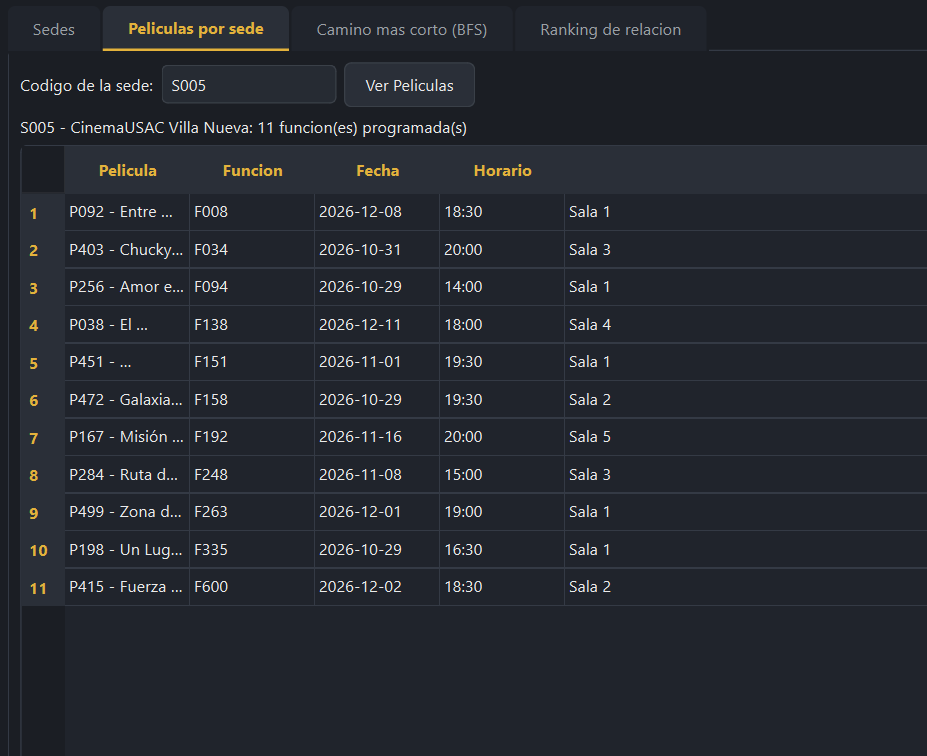

**Camino mas corto (BFS).** Elegir **Origen** y **Destino** y presionar **Buscar Camino Mas Corto**. El sistema muestra la ruta con menos saltos entre las dos sedes, o avisa si no existe camino.

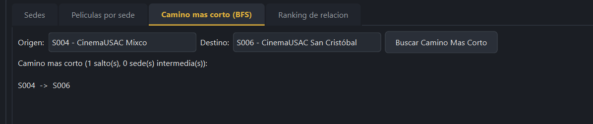

**Ranking de relacion.** Presionar **Generar Ranking de Aristas** para ver los pares de sedes ordenados de mayor a menor cantidad de películas en común.

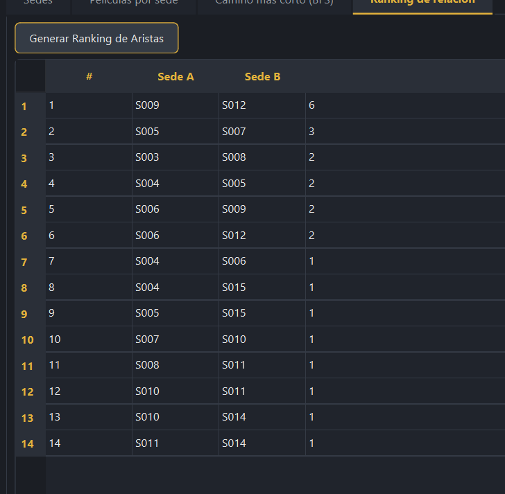

> Las relaciones entre sedes se actualizan solas cada vez que se crea, edita o elimina una función.

### 2.4 Blockchain

Ir a la pestaña **Blockchain (Fase 3)**:

| Botón | Qué hace |
|---|---|
| **Generar Nuevo Bloque** | Mina un bloque con las transacciones pendientes |
| **Ver Reporte de la Blockchain** | Muestra la cadena: verde = íntegro, rojo = manipulado |
| **Ver Arbol de Merkle del Bloque Seleccionado** | Muestra el árbol de Merkle del bloque elegido |
| **Ver Ventas Totales** | Muestra el total de ventas, con desglose por función y por fecha |

Cada **4 compras** el sistema genera un bloque automáticamente, sin que el administrador haga nada. Además, si al cerrar el programa quedan compras sin bloque, el sistema genera uno con ellas para no perderlas. Minar un bloque puede tardar unos segundos (prueba de trabajo).

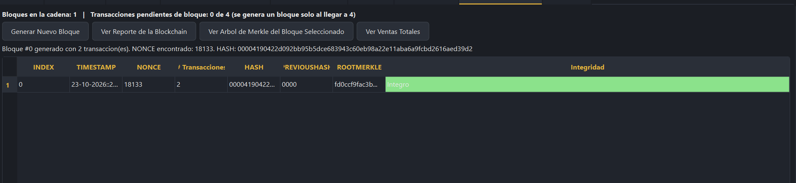

### 2.5 Reportes

Ir a la pestaña **Reportes**. Se navega con **< Anterior** y **Siguiente >**, y se presiona **Generar / Actualizar este reporte** para crear el que se está viendo. Los reportes nuevos de la Fase 3 son:

| Reporte | Qué muestra |
|---|---|
| 9 — Grafo no dirigido de sedes | Cada sede con sus datos y las aristas con su peso |
| 10 — Lista de adyacencia | Cada sede seguida de la lista de sus vecinas y pesos |
| 11 — Blockchain | La cadena de bloques; verde = íntegro, rojo = manipulado |
| 12 — Árbol de Merkle | El árbol del último bloque |

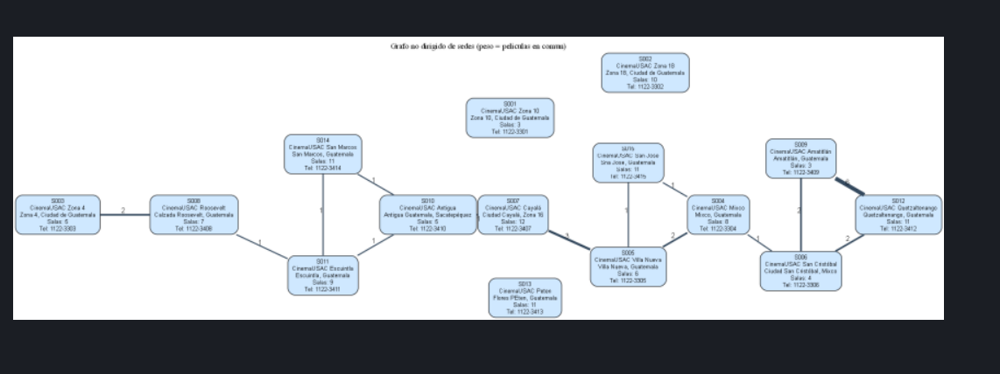

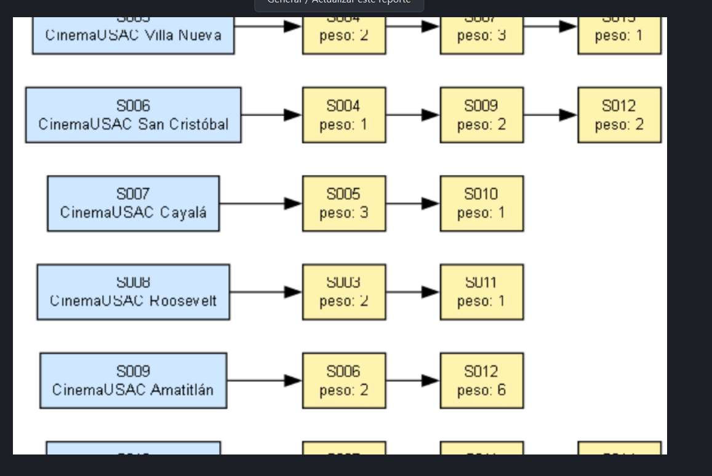

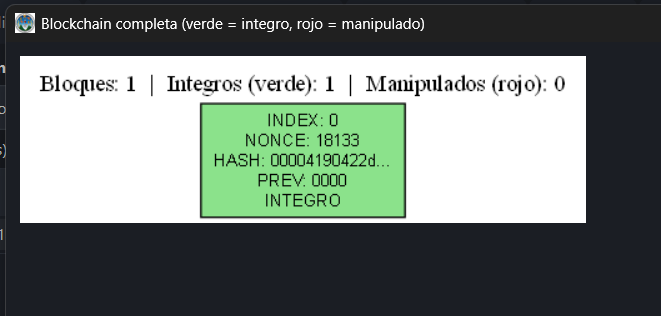

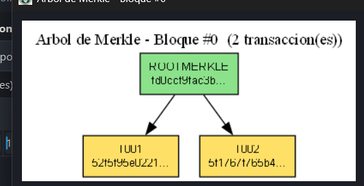

---

## 3. Cliente

### 3.1 Reservar y pagar una función

1. Ingresar como cliente y abrir la pestaña **Reservar**.
2. Elegir **Película**, luego **Sede** y presionar **Ver Disponibilidad**. Se muestra una tabla con las sedes donde está esa película.
3. Elegir la **Función** y marcar los asientos en el mapa.
4. Confirmar. Se abre la ventana de pago: elegir el método (**Tarjeta** o **Efectivo**) y completar los datos.
5. El sistema registra la compra y muestra el código de transacción. El precio por boleto es de **Q 45.00**.

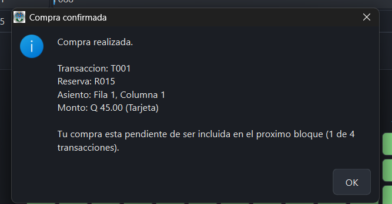

### 3.2 Ver sedes similares

En **Reservar**, después de elegir una sede, presionar **Ver Sedes Similares**. Muestra las sedes con cartelera más parecida, ordenadas de mayor a menor coincidencia.

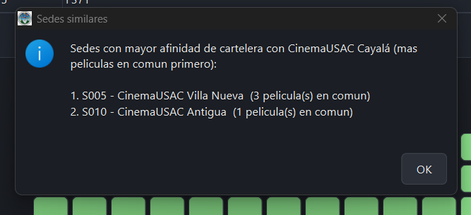

### 3.3 Mis Compras y comprobante

1. Abrir la pestaña **Mis Compras**. Muestra el historial leído directamente de la blockchain.
2. Cada compra indica si está **VALIDA** o **VENCIDA**, según la fecha de la función.
3. Hacer clic en una fila (o escribir el código de transacción) y presionar **Ver Comprobante** para ver el detalle.

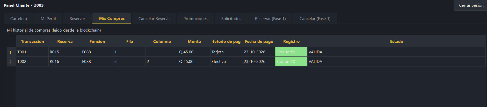

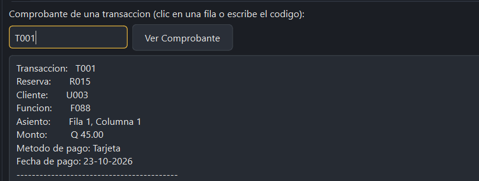

> Una compra aparece en el historial una vez que su transacción queda dentro de un bloque. Mientras espera, está pendiente.

---

## 4. Seguridad de la blockchain

Los bloques se guardan en la carpeta `blocks/` como `block0.json`, `block1.json`, etc. Si alguien edita uno de esos archivos a mano:

1. Al iniciar, el sistema verifica la cadena y detecta el bloque alterado.
2. Aparece el aviso **Blockchain manipulada**, con el índice del primer bloque dañado, los bloques válidos cargados y los descartados.
3. Solo se carga la parte íntegra de la cadena, y las reservas se reconstruyen únicamente a partir de esos bloques.
4. En el reporte de la blockchain, los bloques manipulados aparecen en **rojo**.

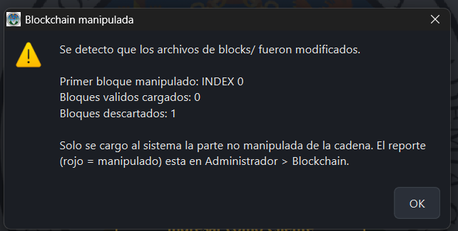

---

## 5. Cerrar el programa

Al cerrar la ventana, el sistema genera un bloque con las compras pendientes (si las hay) y guarda el estado actual de **sedes, películas y funciones** comprimido en `sedes.edd`, `peliculas.edd` y `funciones.edd`. La próxima vez que se abra, se recuperan automáticamente.

> Si se quiere empezar desde cero, cerrar el programa y borrar esos tres archivos.

---

## 6. Problemas frecuentes

| Problema | Solución |
|---|---|
| La carga masiva rechaza casi todo con "ya existe" | Se restauró un estado anterior desde los `.edd`. Cerrar el programa, borrar los tres `.edd` y cargar de nuevo |
| Las funciones de un JSON no aparecen | Cada función debe traer `sede` y `fecha`; revisar el detalle del cuadro de resultado |
| El programa se cierra al abrirlo | Faltan las DLL de Qt; ejecutar `windeployqt --compiler-runtime CinemaUSAC_Fase3.exe` en `build/` |
| Un reporte dice que no se ha generado | Presionar **Generar / Actualizar este reporte**; requiere Graphviz instalado (`dot` en el PATH) |
